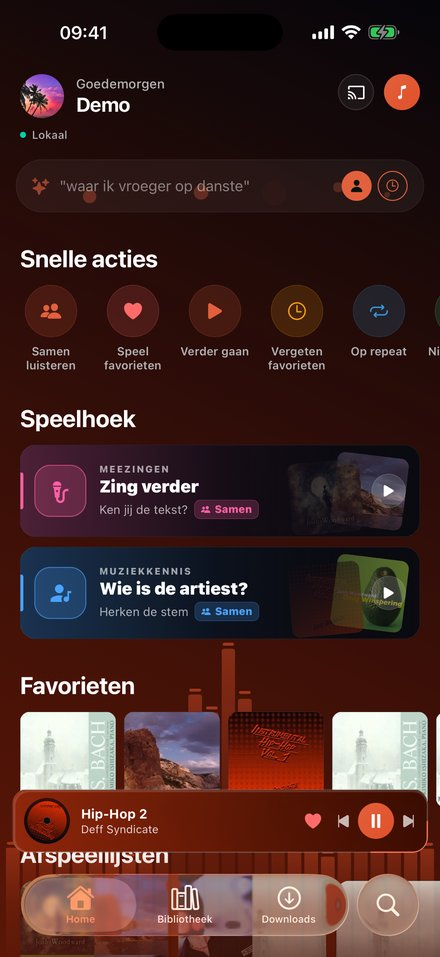
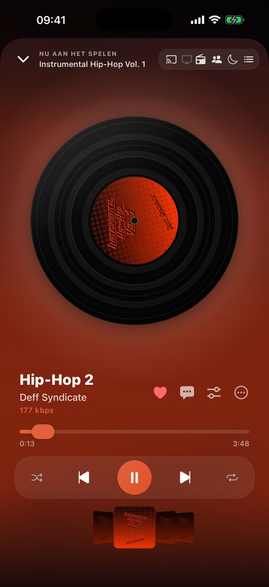
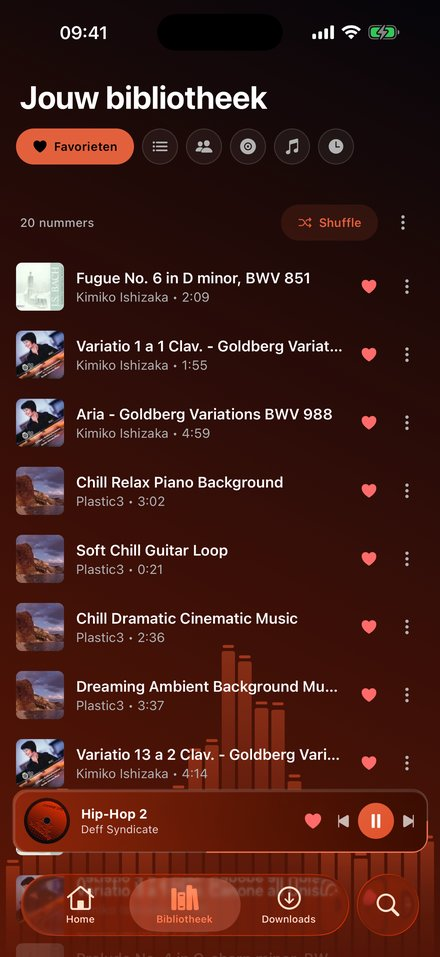
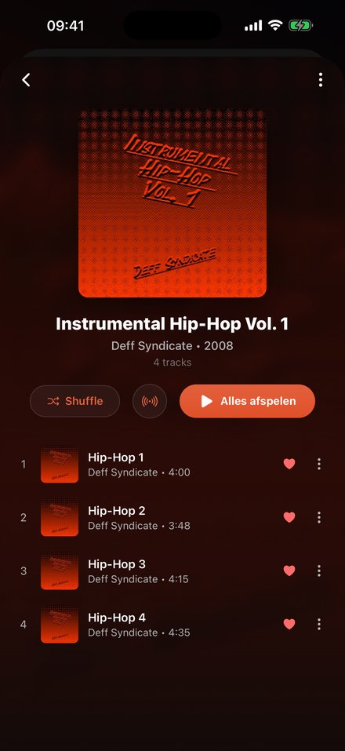
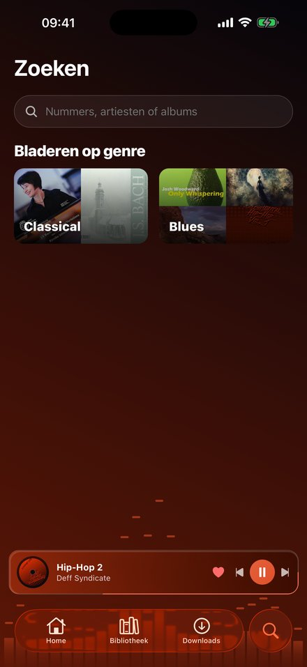
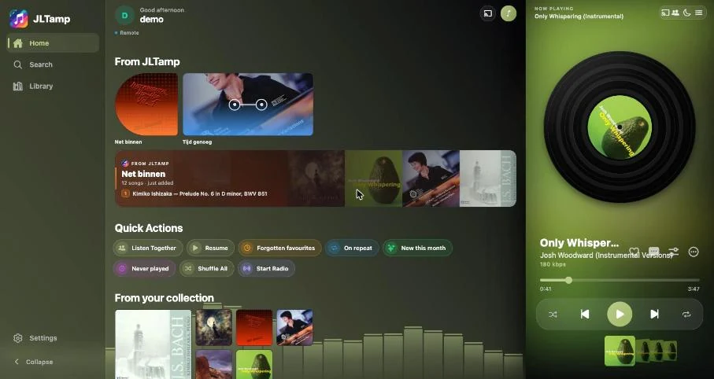
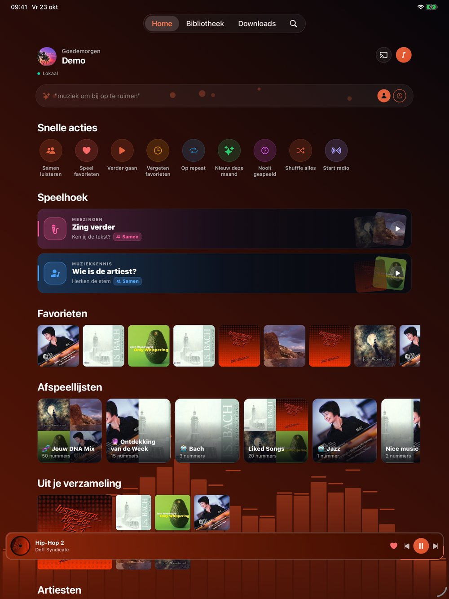

<p align="center">
  
</p>

<h1 align="center">JLTamp Server</h1>

<p align="center">
  A self-hosted music server and the backend for the JLTamp apps.<br>
  Your library, your accounts, your listening data — on hardware you control.
</p>

<p align="center">
  <a href="https://play.google.com/store/apps/details?id=com.jltamp.app"></a>
  <a href="https://apps.apple.com/app/id6807401608"></a>
  
  
  
  <a href="LICENSE"></a>
</p>

<p align="center">
  
  
  
  
  
</p>
<p align="center"><sub>Screenshots show a demo library of freely licensed music.</sub></p>

---

JLTamp Server scans the music you already own and streams it to the JLTamp app
on Android and iOS, to Android Auto and CarPlay, to Chromecast, and to any
browser through the bundled web player. It is multi-user, runs in a single
Docker container with SQLite, and needs no external account or cloud service.

> [!NOTE]
> JLTamp does not provide, host or distribute music. It plays files from your
> own server, and mounts them read-only.

> **Live demo:** [demo.jltamp.nl](https://demo.jltamp.nl) (user `demo`, password `demo`). Resets every night. Details and music credits in [docs/DEMO.md](docs/DEMO.md).

<p align="center"></p>

## Contents

- [Highlights](#highlights)
- [Architecture](#architecture)
- [Quick start](#quick-start)
- [Connecting the app](#connecting-the-app) · [Subsonic clients](#subsonic-clients)
- [Optional components](#optional-components)
- [Configuration](#configuration)
- [Operations](#operations)
- [Security and privacy](#security-and-privacy)
- [Repository layout](#repository-layout)
- [License](#license)

## Highlights

| Area | What you get |
|---|---|
| **Library** | MP3, FLAC, ALAC, WAV, AAC, OGG and Opus. Multiple libraries, a built-in folder browser, incremental rescans, automatic album art and artist images, and loose singles grouped per folder. |
| **Playback** | Crossfade with five curves, volume normalisation, quality selection for mobile data, offline downloads, and lyrics from `.lrc`/`.txt` files and tags (online lookup is opt-in). |
| **Everywhere** | Android, iOS, iPadOS and the web; Android Auto and CarPlay; Chromecast, AirPlay route picker, and handoff between devices. |
| **Together** | *Listen Together* sessions kept in sync by the server, with reactions and host hand-over. Shared playlists with share codes and per-entry attribution. |
| **Discovery** | Smart playlists, a home block of lists built from each user's own listening, *On this day*, *Year in review* and listening stats. |
| **JLTamp Radio** | A 24/7 HLS station mixed from your library, with a weekly programme schedule, artist separation, loudness matching and optional spoken presenters. |
| **Karaoke** | Vocals off or softly guided, lyrics aligned to the vocals, and estimated chords — computed once per track and cached. Sing along for points: the melody is measured from the separated vocals and your voice is compared to it on the device, in a full-screen game with falling notes. |
| **Play along** | Chords, a fretboard or a keyboard that follow the song, with a **Listen** mode that hears whether you play the right chord. Pitch and chord detection run on the phone itself; nothing leaves the device. |
| **Social** | Party mode where guests request and vote from their phone's browser without an account, music quiz games, and two-deck DJ mode. |
| **Subsonic API** | Use Symfonium, Feishin, Substreamer, play:Sub, DSub or any other Subsonic/OpenSubsonic client with this server, alongside the JLTamp apps. |
| **Import** | Rebuild a Spotify playlist, album or track from a link by matching its track list against your own files, using Spotify's official Web API and your own key. |
| **Administration** | Invite-based accounts, per-user library access and rights, a server overview, feature switches without restarts, maintenance mode and nightly database backups. |
| **AI (optional)** | A separate, self-hosted engine for prompt-based playlists, weekly mixes, genre inference and a *New for you* list. |

<p align="center">
  
</p>

## Architecture

```
            ┌───────────────────────────── your network ─────────────────────────────┐
            │                                                                        │
 JLTamp app ├──►  JLTamp Server (this repo, Docker)  ──── read-only ────►  /music     │
 web player │      • FastAPI + SQLite in /data          (local disk, USB or NAS)     │
 Chromecast │      • bundled web UI at /                                             │
 CarPlay /  │      • HLS radio, transcoding (ffmpeg)                                 │
 Android    │                │                                                       │
 Auto       │                ├──► AI engine (ai/, optional)                          │
            │                ├──► Ollama / Piper / Demucs (optional, on the host)    │
            │                └──► Home Assistant (optional)                          │
            └────────────────────────────────────────────────────────────────────────┘
```

Everything optional is off until you configure it, and the app hides features
the server does not offer.

## Quick start

**Requirements:** Docker, and a folder of music the host can read. Images are
published for `linux/amd64` and `linux/arm64` (PC, NAS, Raspberry Pi, Apple
silicon) at `ghcr.io/jltelectronics/jltamp-server`.

**1. Start the container**, pointing the first volume at your music. Keep the
`:ro` suffix; the server never needs to write to your library.

```bash
docker run -d --name jltamp-server --restart unless-stopped \
  -p 32400:32400 \
  -v /path/to/your/music:/music:ro \
  -v jltamp-data:/data \
  ghcr.io/jltelectronics/jltamp-server:latest
```

**2. Or use Compose.** Download [`docker-compose.yml`](docker-compose.yml),
set your music path in `volumes`, and run:

```bash
docker compose up -d
```

To build the image yourself instead, clone the repository and replace the
`image:` line in `docker-compose.yml` with `build: .`.

**3. Create the admin account.** Open <http://localhost:32400>. On first run the
bundled web app shows a setup wizard for the owner account. If you set
`JLTAMP_PASSWORD` instead, sign in with that.

**4. Add a library.** In **Settings → Libraries**, select one or more folders in
the folder browser and start a scan. Your music then appears in the web player
and in the apps.

All writable state lives in the `jltamp-data` volume and survives rebuilds.

### Unraid and CasaOS

**Unraid:** download the template once from the Unraid terminal, then pick
*JLTamp-Server* under **Docker → Add Container → Template**:

```bash
wget -O /boot/config/plugins/dockerMan/templates-user/my-JLTamp-Server.xml \
  https://raw.githubusercontent.com/JLTelectronics/JLTamp-server/main/deploy/unraid/jltamp-server.xml
```

Set the music share (read-only) and the appdata path, and choose another host
port if Plex already uses 32400.

**CasaOS:** **App Store → Custom Install → Import**, and paste
[`deploy/casaos/docker-compose.yml`](deploy/casaos/docker-compose.yml). It
expects your music in `/DATA/Media/Music`; change that path if yours lives
elsewhere.

If the library stays empty on CasaOS:

1. **Point `/music` at your music.** Only the folder mounted as `/music` is
   visible to JLTamp. If your music is somewhere else, for example on a USB
   drive under `/media/...`, open the JLTamp app settings in CasaOS, set the
   host path of the `/music` volume to that folder and save.
2. **Add a library.** JLTamp does not scan on its own. In **Settings →
   Libraries**, pick `/music` (or a folder inside it) in the folder browser,
   not the host path, and start a scan.
3. **Check the folder browser.** If `/music` is empty there, the volume in
   step 1 still points at the wrong folder.

### Using a NAS

Mount the share (SMB, NFS or CIFS) on the **host** and pass the mount point as
the `/music` volume. The folder browser is confined to the music mount and
cannot reach the rest of the filesystem.

**Settings → Libraries → Discover NAS** lists file-share devices found over
mDNS to help you find the address to mount. Discovery generally needs
`network_mode: host`, because Docker's default bridge network blocks mDNS.

## Connecting the app

Install JLTamp from [Google Play](https://play.google.com/store/apps/details?id=com.jltamp.app)
or the [App Store](https://apps.apple.com/app/id6807401608) (iOS and iPadOS
16.4 or later), choose **Connect your own server**, and enter its address —
for example `http://192.168.1.10:32400` on your LAN, or your HTTPS address
behind a reverse proxy. The app can also connect to an existing Plex server.

### Subsonic clients

The server also speaks the [Subsonic API](https://www.subsonic.org/pages/api.jsp)
(1.16.1, with the OpenSubsonic extensions `formPost`, `songLyrics` and
`apiKeyAuthentication`), so existing clients such as Symfonium, Feishin,
Substreamer, play:Sub, DSub or Tempo work too.

In the JLTamp app, open **Settings → Subsonic apps** and create an app password.
Then enter in your client:

| Field | Value |
|---|---|
| Server | your server address, e.g. `http://192.168.1.10:32400` |
| Username | your JLTamp email address |
| Password | the app password |

The app password is separate from your account password because most clients
log in with a salted hash that the server can only verify against a stored
secret. Clients that send the password itself also accept your normal password.
A star on a track is a like in *Liked Songs*, so it shows up in the JLTamp app as
well. Library access, playlists and history follow the same rules as the app.
Administrators can switch the API off under **Admin → Server**.

## Optional components

<details>
<summary><b>AI engine</b> — prompt-based playlists and weekly mixes</summary>

<br>

A separate service in [`ai/`](ai/) that embeds your library locally. Describe a
mood ("a calm Sunday morning with coffee") and get a playlist from your own
music, plus weekly *DNA Mix* and *Discovery* playlists, genre inference for
untagged files, tempo-aware radio and a *New for you* list after new music is
scanned. Prompts are understood in every language the app supports.

Serve it under `/ai/*` on the same domain as the server, or on port `5000` on
your LAN; the app picks it up automatically. Setup: [`ai/README.md`](ai/README.md).

</details>

<details>
<summary><b>Spotify import</b> — rebuild a playlist from a link</summary>

<br>

The importer reads track names and artists through the official
[Spotify Web API](https://developer.spotify.com/documentation/web-api) and
matches them against your files. No audio is fetched. Tracks you don't have keep
their position and are filled in automatically after a later scan finds them.

1. Create an app in the [Spotify developer dashboard](https://developer.spotify.com/dashboard)
   and register `https://your-domain.example/spotify/callback` as a Redirect URI.
2. Enter the client ID and secret under **Admin → Spotify**, or set
   `SPOTIFY_CLIENT_ID` and `SPOTIFY_CLIENT_SECRET`. Albums and tracks work from here.
3. For playlists, choose **Link** once and sign in with a Spotify account.
4. Enable the importer with `JLTAMP_IMPORTERS=true` or its switch in Admin.

</details>

<details>
<summary><b>Radio presenters</b> — spoken links between tracks</summary>

<br>

JLTamp Radio runs without any extra service. For presenters, point
`JLTAMP_AI_URL` at an Ollama instance for the scripts, and `JLTAMP_PIPER_URL`
(or `JLTAMP_PIPER_MODEL`) at a Piper voice for speech. The music is ducked under
the voice. Enable **Radio** in Admin.

</details>

<details>
<summary><b>Karaoke and chords</b> — source separation</summary>

<br>

Vocal separation uses Demucs, either installed in the container or as a service
on the host via `JLTAMP_KARAOKE_URL` (useful when the host has a GPU). Results
are cached under `/data/karaoke`, capped by `JLTAMP_KARAOKE_MAX_MB`. Enable
**Karaoke** and **Chords** in Admin.

</details>

<details>
<summary><b>Home Assistant</b> — speakers and lights</summary>

<br>

With `HA_URL` and `HA_TOKEN` set, the server owner can play on media players in
the house and let lights follow the colours of the current cover. Available to
the owner account only.

</details>

<details>
<summary><b>Email</b> — invitations and password resets</summary>

<br>

Set `SMTP_HOST`, `SMTP_PORT`, `SMTP_USER`, `SMTP_PASSWORD` and `SMTP_FROM`
(plus `SMTP_SSL=true` for port 465). Without SMTP, invitations produce a link to
share by hand.

</details>

## Configuration

All settings are environment variables; see [`.env.example`](.env.example) and
`docker-compose.yml`. Most feature switches can also be changed at runtime in
**Admin**, which takes precedence over the environment.

**Core**

| Variable | Default | Description |
|---|---|---|
| `MUSIC_DIR` | `/music` | Library path inside the container (read-only) |
| `DATA_DIR` | `/data` | Database, artwork cache, backups |
| `PORT` | `32400` | HTTP port |
| `SERVER_NAME` | `JLTamp` | Name shown in the apps |
| `PUBLIC_URL` | — | Public address, used in mails, party links and the Spotify callback |
| `LOCAL_URL` | — | Optional LAN address(es) for faster streaming at home |
| `RESCAN_INTERVAL_MIN` | `0` | Automatic rescan interval; `0` means manual only |
| `JLTAMP_MAX_TRANSCODES` | `12` | Maximum concurrent ffmpeg transcodes |

**Accounts**

| Variable | Default | Description |
|---|---|---|
| `JLTAMP_ADMIN_EMAIL` | `admin@example.com` | Owner account email |
| `JLTAMP_PASSWORD` | `changeme` | Fallback owner password; **change it** or use the setup wizard |
| `JLTAMP_OPEN_REGISTRATION` | `false` | `true` lets anyone register; otherwise invite-only |
| `SMTP_*` | — | Outgoing mail, see [Email](#optional-components) |

**Features**

| Variable | Default | Description |
|---|---|---|
| `JLTAMP_IMPORTERS` | `false` | Enables the playlist importers; when off, the endpoints return 403 and the app hides them |
| `JLTAMP_DEMO` | `false` | Public-demo mode for a shared account: deleting the account and uploading an avatar are refused, and the app hides the delete option |
| `SPOTIFY_CLIENT_ID` / `SPOTIFY_CLIENT_SECRET` | — | Your Spotify app key (also settable in Admin; `IMPORT_CLIENT_*` still accepted) |
| `JLTAMP_LYRICS_ONLINE` | `false` | Default for the online lyrics lookup |
| `JLTAMP_AI_URL` / `JLTAMP_AI_MODEL` | Ollama on the host | LLM for presenters and artist information |
| `JLTAMP_PIPER_URL` / `JLTAMP_PIPER_MODEL` | — | Text-to-speech for presenters |
| `JLTAMP_RADIO_*` | see `app/config.py` | Radio bitrate, segment length, crossfade, ducking, library selection |
| `JLTAMP_KARAOKE_URL` | — | External separation service; empty uses Demucs in the container if present |
| `JLTAMP_KARAOKE_MAX_MB` | `4000` | Karaoke cache size limit |
| `HA_URL` / `HA_TOKEN` | — | Home Assistant connection |

## Operations

- **Updating:** `docker compose pull && docker compose up -d` (or `git pull`
  and `--build` if you build it yourself). Database migrations run
  automatically at start-up. `:latest` follows releases; `:edge` follows `main`.
- **Backups:** nightly SQLite backups are written to `/data/backups` (on by
  default, retention configurable in Admin). Back up the `jltamp-data` volume
  as a whole for artwork and caches too.
- **Monitoring:** **Admin → Overview** shows service health, disk usage,
  connected devices, active sessions and recent crash reports from the apps.
- **Maintenance mode:** regular users see a maintenance screen while
  administrators keep full access.
- **Remote access:** keep the server on your LAN and use a VPN such as
  [Tailscale](https://tailscale.com/), or publish it behind a reverse proxy with
  HTTPS (Caddy, nginx). Do not expose the raw port to the internet.

## Security and privacy

- The music mount is read-only; the server writes only to `/data`.
- Passwords are hashed; every device gets its own revocable token.
- Library access is granted per user, and artwork is access-checked, so users
  cannot fetch covers from libraries or playlists they cannot see.
- The folder browser is confined to the music mount.
- No telemetry and no external sign-in. Outbound requests are limited to
  artwork and metadata lookups, plus the services you configure yourself.
- A template privacy policy is served at `/privacy`
  (`app/static/privacy.html`); add your own contact details before you publish
  the server.

Please report security issues privately to the maintainers rather than in a
public issue.

## Repository layout

```
app/          FastAPI server: routers, scanner, radio, karaoke, static pages
ai/           optional AI engine (separate service, own README)
web/          prebuilt web player, served at /
docs/         images used in this README
deploy/       Unraid template and CasaOS app
Dockerfile    single-container image (python:3.12-slim + ffmpeg)
docker-compose.yml
```

## License

Released under the [GNU General Public License v3.0 or later](LICENSE). © 2026 JLT Electronics.

The JLTamp name and logo are not covered by the license; they remain the property of JLT Electronics. See [TRADEMARKS.md](TRADEMARKS.md).
